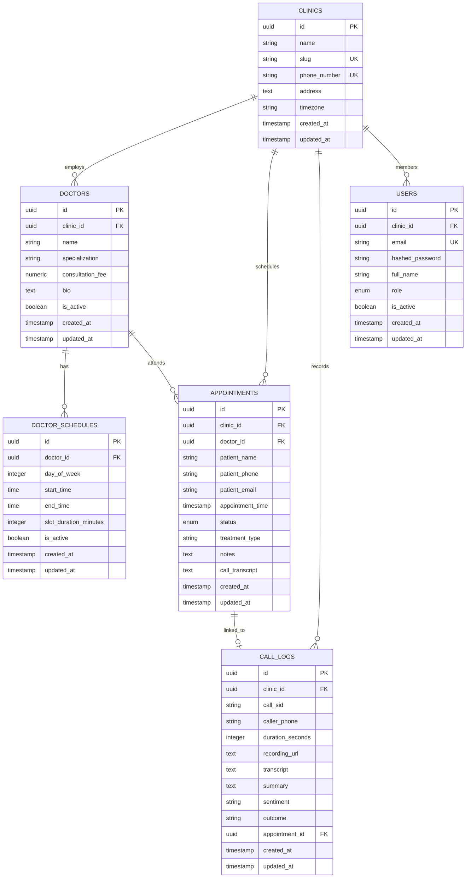

# AyurVoice SaaS - Database Schema & ER Design

The database is built on PostgreSQL with multi-tenant row-level isolation via `clinic_id`.

---

## 1. Table Specifications

### `clinics`
- `id` (UUID, Primary Key)
- `name` (VARCHAR(255), Not Null)
- `slug` (VARCHAR(100), Unique, Indexed)
- `phone_number` (VARCHAR(50), Unique, Indexed) - Twilio inbound DID
- `address` (TEXT, Nullable)
- `timezone` (VARCHAR(50), Default: "Asia/Kolkata")
- `created_at`, `updated_at` (TIMESTAMP WITH TIME ZONE)

### `doctors`
- `id` (UUID, Primary Key)
- `clinic_id` (UUID, Foreign Key -> `clinics.id`, Indexed, Cascade Delete)
- `name` (VARCHAR(255), Not Null)
- `specialization` (VARCHAR(255), Not Null)
- `consultation_fee` (NUMERIC(10,2), Default: 500.00)
- `bio` (TEXT, Nullable)
- `is_active` (BOOLEAN, Default: true)

### `doctor_schedules`
- `id` (UUID, Primary Key)
- `doctor_id` (UUID, Foreign Key -> `doctors.id`, Indexed, Cascade Delete)
- `day_of_week` (INTEGER, 0=Monday to 6=Sunday)
- `start_time` (TIME, Not Null)
- `end_time` (TIME, Not Null)
- `slot_duration_minutes` (INTEGER, Default: 30)
- `is_active` (BOOLEAN, Default: true)

### `appointments`
- `id` (UUID, Primary Key)
- `clinic_id` (UUID, Foreign Key -> `clinics.id`, Indexed, Cascade Delete)
- `doctor_id` (UUID, Foreign Key -> `doctors.id`, Indexed, Cascade Delete)
- `patient_name` (VARCHAR(255), Not Null)
- `patient_phone` (VARCHAR(50), Indexed, Not Null)
- `patient_email` (VARCHAR(255), Nullable)
- `appointment_time` (TIMESTAMP WITH TIME ZONE, Indexed, Not Null)
- `status` (ENUM: `booked`, `completed`, `cancelled`, `no_show`)
- `treatment_type` (VARCHAR(255), Nullable)
- `notes` (TEXT, Nullable)
- `call_transcript` (TEXT, Nullable)

### `call_logs`
- `id` (UUID, Primary Key)
- `clinic_id` (UUID, Foreign Key -> `clinics.id`, Indexed, Cascade Delete)
- `call_sid` (VARCHAR(100), Indexed, Nullable)
- `caller_phone` (VARCHAR(50), Not Null)
- `duration_seconds` (INTEGER, Nullable)
- `recording_url` (TEXT, Nullable)
- `transcript` (TEXT, Nullable)
- `summary` (TEXT, Nullable)
- `sentiment` (VARCHAR(50), Nullable)
- `outcome` (VARCHAR(100), Nullable)
- `appointment_id` (UUID, Foreign Key -> `appointments.id`, Nullable, OnDelete: SET NULL)

### `users`
- `id` (UUID, Primary Key)
- `clinic_id` (UUID, Foreign Key -> `clinics.id`, Nullable for Super Admin)
- `email` (VARCHAR(255), Unique, Indexed)
- `hashed_password` (VARCHAR(255), Salted Bcrypt)
- `full_name` (VARCHAR(255), Not Null)
- `role` (ENUM: `super_admin`, `clinic_admin`)
- `is_active` (BOOLEAN, Default: true)

